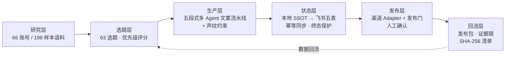

# GoGlobal Content Crew

品牌出海多平台图文获客 Agent 流水线。
一人公司 + 多 Agent：从选题、文案、渠道适配到发布门与证据回流，把内容获客做成一条可审计的管道。

雪窦山 AIGC+OPC 品牌出海赛道（Q3 决赛）· AI 图文获客子赛道（小红书 / INS / X / Discord / Reddit）。

## 这是什么

一个已经在真实运行的内容获客工作台：创始人的自有内容矩阵（国内平台）作为生产环境 pilot，海外平台（X / Reddit / INS / Discord）作为 adapter 扩展方向。系统的核心判断只有一个：

**获客内容的瓶颈不是生成，是持续供给平台原生形态内容的工程纪律。**

单条内容谁都能写。品牌出海真正难的是：每周在 5 个语言文化不同的平台，保持原生语感、稳定产量、可复盘的数据回流。这件事对一人公司只有一条解法：把内容生产做成管道，人只守判断点。

## 架构一览



详细设计见 [docs/02-architecture.md](docs/02-architecture.md)。

## 关键数据（全部真实可核验）

| 维度 | 数据 | 口径说明 |
|---|---|---|
| 研究语料 | 66 竞品账号 / 198 内容样本 / 7 平台 | 90 条真实 URL，抽检通过率 80% |
| 选题资产 | 63 选题入册 / 11 个方向 | 优先级评分模型（160-250 分） |
| 素材管线 | 814 条素材全量索引 | 两次实拍事件，4 级质量判定 |
| 成片迭代 | 10 版粗剪 + 4 份完整脚本 | 含 EDL 审阅文档线上链路 |
| CMS 工程 | 五表 398 行幂等同步 | 重跑 create=0，终态保护实测 |
| 人效 | 单集 3-5.5 小时 | 一人产出多渠道交付包 |

诚实口径声明：系统处于产能爬坡早期，新品牌已发布内容 1 条，互动数据暂无回流。因此业务价值按产能与人效口径陈述，不用增长口径。依据见 [docs/04-metrics.md](docs/04-metrics.md)。

## Demo

- 5 分钟看懂编排逻辑：[docs/03-demo.md](docs/03-demo.md)
- 可运行的最小核心环：`demo/run_demo.py`（一个选题 → 五平台原生文案草稿，声纹约束生效；支持无 API key 的 dry-run 模式）

```bash
cd demo
python3 run_demo.py --dry-run          # 查看完整编排，不需要任何 key
python3 run_demo.py --topic "..."      # 真实生成（自带 OpenAI 兼容端点）
```

## 文档导航（按评审维度）

| 评审维度 | 权重 | 文档 |
|---|---|---|
| 业务需求与痛点 | 15% | [docs/01-problem.md](docs/01-problem.md) |
| Agent 技术方案 | 25% | [docs/02-architecture.md](docs/02-architecture.md) |
| 产品或网站 Demo | 20% | [docs/03-demo.md](docs/03-demo.md) + `demo/` |
| 业务价值与实际效益 | 25% | [docs/04-metrics.md](docs/04-metrics.md) |
| 创新性与可扩展性 + 合规 | 15% | [docs/05-roadmap.md](docs/05-roadmap.md) |

## 团队

一人团队（OPC 模式本尊）。队长负责选题判断、声纹审核、发布门确认；Agent 负责产能。
